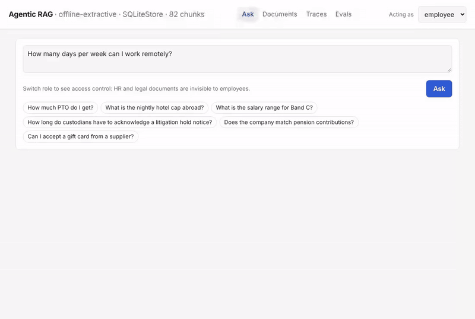
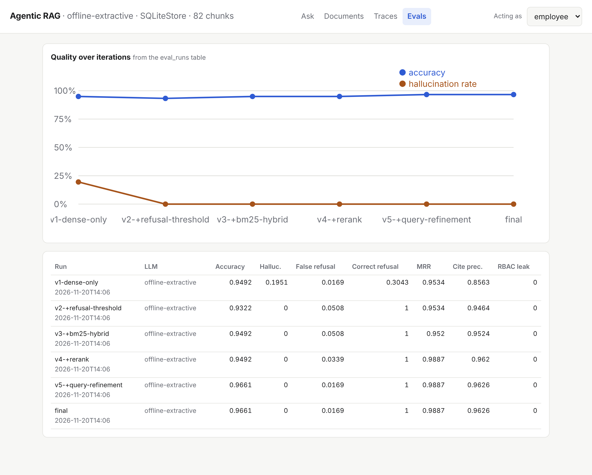
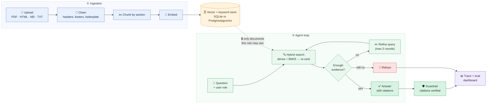

# Agentic RAG with self-evaluation

[](https://github.com/JaafarWafa/agentic-rag/actions)

A document Q&A assistant for company policies. It **searches, checks its evidence, re-searches when needed, answers with cited sources**, and **says "I don't know"** when the answer isn't in the documents. Each user only sees the documents their role allows (employee, HR, legal…).

It comes with an **evaluation harness** of 82 test questions that measures the system's own hallucination rate on every commit.

## Demo



1. An employee asks about maternity leave. The first search is weak, so the agent rewrites the query and answers with a source.
2. The same employee asks about salary bands and is refused: HR documents are invisible to that role.
3. Switched to the HR role, the same question is answered.

## Results

Each step adds one component and is measured on the same 82 questions:

| Version | Accuracy | Hallucination rate | False refusals |
|---|---|---|---|
| Basic RAG (vector search, always answers) | 94.9% | **19.5%** | 1.7% |
| + refuses when evidence is weak | 93.2% | **0%** | 5.1% |
| + keyword search (hybrid) | 94.9% | 0% | 5.1% |
| + re-ranking | 94.9% | 0% | 3.4% |
| **+ query refinement (final)** | **96.6%** | **0%** | **1.7%** |

- On 27 **held-out** questions never used for tuning: 100% accuracy, 0% hallucination.
- **0 access-control leaks**: restricted documents never reach the model.



## Architecture



## Tech stack

| Area | Tools |
|---|---|
| Backend | Python, FastAPI |
| Retrieval | Hybrid search (vector + BM25), Reciprocal Rank Fusion, re-ranking |
| Storage | PostgreSQL + pgvector, or SQLite (FTS5) |
| LLM agent | Claude via tool use, or an offline mode that needs no API key |
| Access control | Role-based filtering inside the database query |
| Evaluation | Custom harness: groundedness, hallucination rate, refusals, retrieval MRR, leak detection |
| Ops | Docker, docker-compose, GitHub Actions CI with quality gates, Render deployment |

## How it's evaluated

The test set has 82 questions in four types: **answerable**, **reworded** (different words from the documents), **unanswerable**, and **restricted** (the answer exists but the user's role can't see it).

Every run measures accuracy, hallucination rate, correct and false refusals, citation precision and access-control leaks, and is saved so progress can be tracked over time. CI fails the build if the hallucination rate goes above 5% or any leak appears.

## Run it

```bash
pip install -r requirements-dev.txt
uvicorn app.main:app --port 8000      # open http://localhost:8000
python -m evals.run_eval              # run the evaluation
```

Setup, configuration, API and deployment details: [docs/DEVELOPMENT.md](docs/DEVELOPMENT.md).
